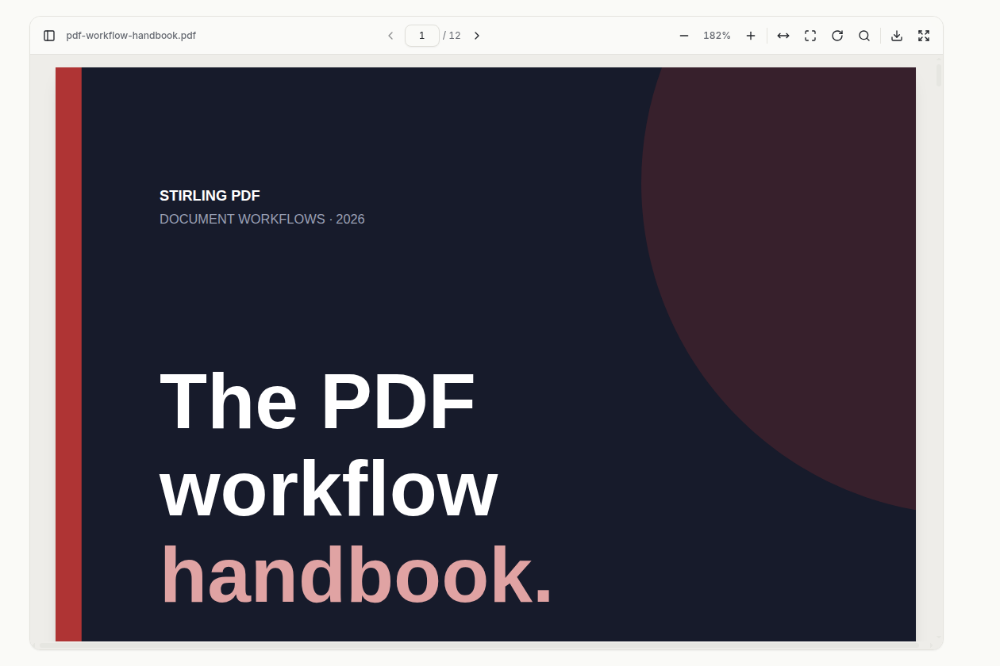
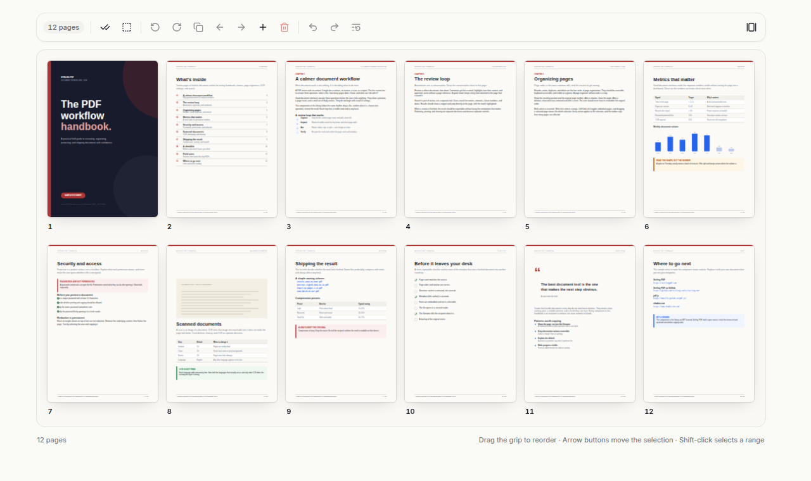
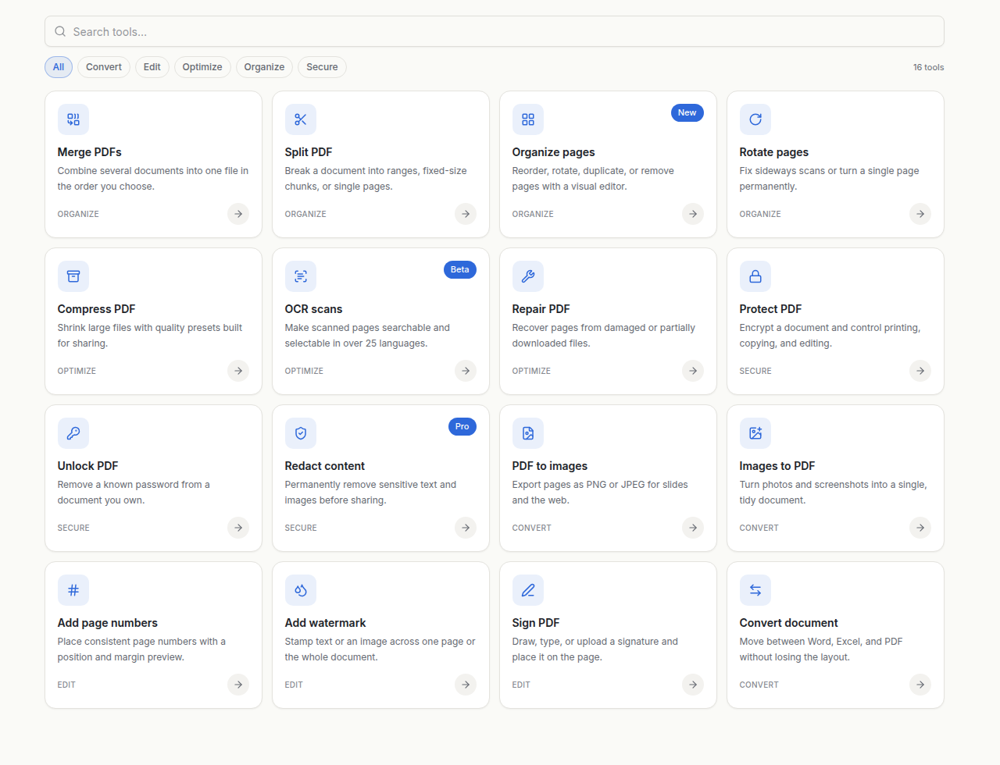
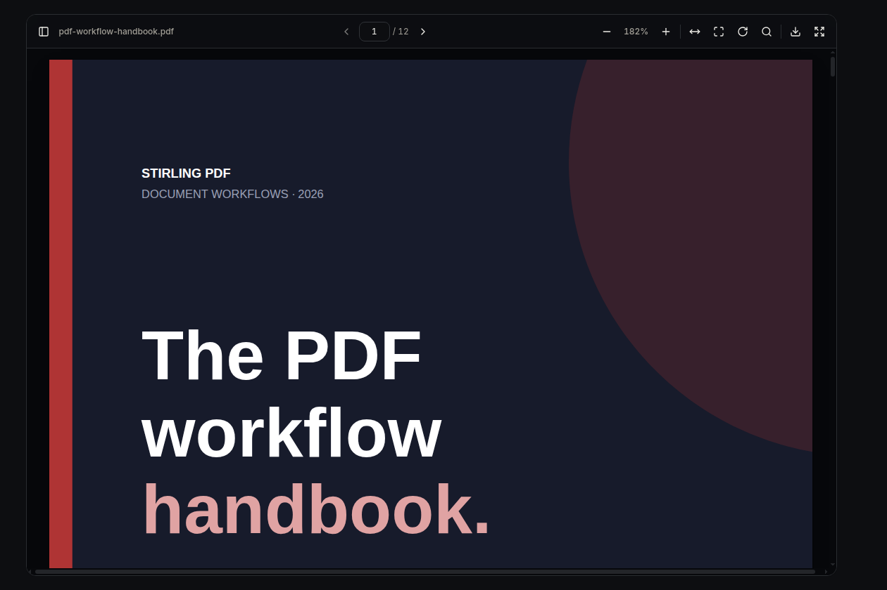
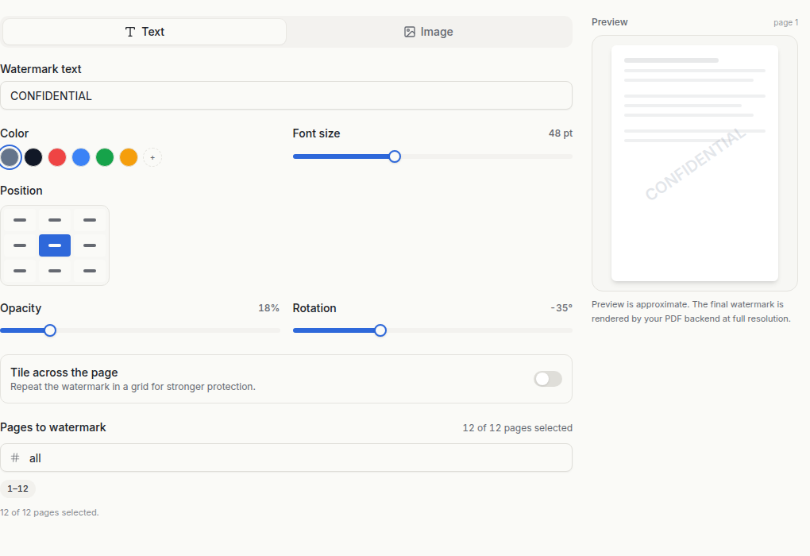

# Stirling PDF UI Components

**Beautiful, accessible Vue 3 components for building PDF applications.**

A focused library of document surfaces: upload, preview, search, organize, protect, compress, OCR,
sign, and deliver PDFs. Built with Vue 3, TypeScript, Tailwind v4, and shadcn-vue conventions, with
Storybook stories for every PDF component and a showcase for the UI primitives.

[](https://vuejs.org)
[](https://www.typescriptlang.org)
[](https://storybook.js.org)
[](LICENSE)

<p align="center">
  
</p>

> **Unofficial community project.** This library is inspired by the excellent
> [Stirling PDF](https://github.com/Stirling-Tools/Stirling-PDF) frontend. It is not affiliated with
> Stirling PDF Inc.

---

## Why this library

Most PDF apps rebuild the same surfaces: a dropzone, a file list, a viewer, a page organizer, a
password form, a result panel. The details that make them trustworthy are easy to skip when every
app starts from zero: lazy page rendering, keyboard selection, undo, progress states, accessible
labels, dark mode.

This library centralizes those surfaces so you can spend your time on the workflow that makes your
product different.

- **28 PDF components** and **31 UI primitives**, all exported with TypeScript types.
- **PDF.js inside** — continuous scroll, selectable text, fit modes, rotation, search highlights,
  thumbnails, and password unlock.
- **A real page editor** — drag or keyboard reorder, multi-select, rotate, duplicate, delete, insert
  blank pages, undo, redo, and reset.
- **Task panels, not just inputs** — watermark and page-number previews, compression estimates, OCR
  language search, split previews, signature capture.
- **Designed for shadcn-vue** — semantic CSS variables, `class` passthrough on every component, and
  `cn()` class merging. Works without Tailwind in the host app.
- **Lean in a shadcn app** — Reka UI, Lucide, `clsx`, `tailwind-merge`, and
  `class-variance-authority` stay peers, so your app keeps one copy of each. A single-component
  import adds roughly 5 kB; PDF.js is a separate lazy chunk that only loads with the viewer.
- **Accessible by default** — labelled controls, roving tab focus, keyboard shortcuts, focus rings,
  reduced-motion support, and an a11y addon in Storybook.
- **Zero global style leakage** — the shipped stylesheet omits Tailwind preflight and scopes its
  reset to `.spdf`.
- **MIT licensed**, with no runtime service, account, or commercial dependency.

## Screenshots

| Viewer | Page organizer |
| --- | --- |
|  |  |

| Tool catalog | Dark mode |
| --- | --- |
|  |  |

| Watermark settings | Signature capture |
| --- | --- |
|  |  |

## Requirements

- **Vue 3.5+**
- **Node 22.13+** for development (PDF.js v6 requires it)
- **pdfjs-dist 5.4+ or 6.x** for the PDF.js-backed components. Optional if you only import from
  [`/core`](#engine-free-entry)
- **reka-ui 2.x, @lucide/vue 1.x, clsx, tailwind-merge, and class-variance-authority** — a
  shadcn-vue app already ships these
- A bundler that supports ESM (Vite, Nuxt, Rollup, webpack 5, Rspack, …)

The library is client-side only. If you use Nuxt or another SSR framework, render the PDF
components inside `<ClientOnly>`.

## Install

```bash
pnpm add @mheers/stirling-pdf-ui-components pdfjs-dist
```

```bash
npm install @mheers/stirling-pdf-ui-components pdfjs-dist
```

### Peer dependencies

The shared shadcn-vue building blocks are peers, not bundled copies:

`reka-ui`, `@lucide/vue`, `clsx`, `tailwind-merge`, `class-variance-authority`, `vue`, and
`pdfjs-dist`.

A shadcn-vue app already has the first five. Package managers with automatic peer installation
(pnpm 10, npm 7+, Yarn Berry) install anything missing. With `auto-install-peers=false`, add them
explicitly. This is what keeps the library lean: importing only `Button` adds roughly 5 kB of code
on top of the peers your app already ships, instead of a second copy of Reka UI and the icon set.

`pdfjs-dist` is only loaded when a component that renders pages mounts. Components such as
`PdfDropzone`, `PdfToolGrid`, or `PdfMetadataForm` never import the engine.

### Engine-free entry

If your app already has a PDF renderer, import the UI and form surfaces from `/core`:

```ts
import {
  PdfDropzone,
  PdfFileList,
  PdfMetadataForm,
  PdfProcessingState,
  PdfResultPanel,
  PdfToolGrid,
  WatermarkSettings,
} from '@mheers/stirling-pdf-ui-components/core';
```

That entry never imports `pdfjs-dist`. It includes the upload/file/tool surfaces, task forms,
signature capture, page-range and position controls, results, the search results panel, and all UI
primitives. You still import `style.css`, and the shared shadcn peers (`reka-ui`, `@lucide/vue`,
`clsx`, `tailwind-merge`, `class-variance-authority`) are still used.

The PDF.js-backed components (`PdfViewer`, `PdfThumbnail`, `PdfThumbnailSidebar`, `PdfPageCanvas`,
`PdfPageGrid`, `PdfPageOrganizer`, and `PdfDocumentInfo`) live only in the main entry.

## Quick start

### 1. Configure the PDF.js worker

Call this once at application start-up, before the first viewer or thumbnail mounts.

```ts
// main.ts
import { createApp } from 'vue';
import { configurePdfJs } from '@mheers/stirling-pdf-ui-components';
import workerUrl from 'pdfjs-dist/build/pdf.worker.min.mjs?url';

import '@mheers/stirling-pdf-ui-components/style.css';
import App from './App.vue';

configurePdfJs({ workerSrc: workerUrl });

createApp(App).mount('#app');
```

With webpack, copy `node_modules/pdfjs-dist/build/pdf.worker.min.mjs` into your public folder and
pass its URL instead.

### 2. Render a document

```vue
<script setup lang="ts">
import { ref } from 'vue';
import { PdfDropzone, PdfViewer } from '@mheers/stirling-pdf-ui-components';

const file = ref<File | null>(null);
</script>

<template>
  <PdfDropzone
    v-if="!file"
    :multiple="false"
    title="Open a PDF"
    @files="file = $event[0] ?? null"
  />

  <PdfViewer
    v-else
    :source="file"
    :filename="file.name"
    show-thumbnails
    allow-print
  />
</template>
```

`PdfViewer` accepts a `File`, `Blob`, `ArrayBuffer`, `Uint8Array`, URL string, or `URL`.

## Components

### Files and uploads

| Component | What it does |
| --- | --- |
| [`PdfDropzone`](src/components/pdf/PdfDropzone.vue) | Accessible drag-and-drop with type, size, and count validation |
| [`PdfFileCard`](src/components/pdf/PdfFileCard.vue) | File row with thumbnail, status, progress, retry, and selection |
| [`PdfFileList`](src/components/pdf/PdfFileList.vue) | Reorderable, selectable file queue with keyboard support |

### View, search, and inspect

| Component | What it does |
| --- | --- |
| [`PdfViewer`](src/components/pdf/PdfViewer.vue) | Continuous viewer with lazy pages, text layer, zoom, rotation, search, download, print, fullscreen, and password unlock |
| [`PdfViewerToolbar`](src/components/pdf/PdfViewerToolbar.vue) | Standalone toolbar for a custom viewer |
| [`PdfThumbnailSidebar`](src/components/pdf/PdfThumbnailSidebar.vue) | Page rail with current-page tracking |
| [`PdfPageCanvas`](src/components/pdf/PdfPageCanvas.vue) | One rendered page with text selection and search highlights |
| [`PdfSearchPanel`](src/components/pdf/PdfSearchPanel.vue) | Grouped search results with highlighted snippets |
| [`PdfDocumentInfo`](src/components/pdf/PdfDocumentInfo.vue) | Page count, size, version, metadata, and protection status |

### Pages and selection

| Component | What it does |
| --- | --- |
| [`PdfThumbnail`](src/components/pdf/PdfThumbnail.vue) | Lazy, shared-document page thumbnail |
| [`PdfPageGrid`](src/components/pdf/PdfPageGrid.vue) | Responsive selection grid with shift/ctrl semantics |
| [`PdfPageOrganizer`](src/components/pdf/PdfPageOrganizer.vue) | Reorder, rotate, duplicate, delete, insert blanks, undo/redo/reset |
| [`PageRangeInput`](src/components/pdf/PageRangeInput.vue) | `1-3, 5, 8-10`, `all`, `odd`, `even`, `last`, and open ranges, with an interactive page strip |
| [`PdfPositionPicker`](src/components/pdf/PdfPositionPicker.vue) | Accessible nine-point anchor picker |

### Tool catalogs

| Component | What it does |
| --- | --- |
| [`PdfToolCard`](src/components/pdf/PdfToolCard.vue) | One tool card with icon, description, badge, and hover action |
| [`PdfToolGrid`](src/components/pdf/PdfToolGrid.vue) | Searchable, category-filtered, optionally grouped tool catalog |
| [`PdfToolHeader`](src/components/pdf/PdfToolHeader.vue) | Consistent tool page header with back action and actions slot |

### Task panels

| Component | What it does |
| --- | --- |
| [`PdfMetadataForm`](src/components/pdf/PdfMetadataForm.vue) | Title, author, subject, keyword chips, creator, producer |
| [`PdfPasswordForm`](src/components/pdf/PdfPasswordForm.vue) | Protect or unlock, strength meter, confirm, owner password, permissions |
| [`WatermarkSettings`](src/components/pdf/WatermarkSettings.vue) | Text or image, position, color, opacity, rotation, tiling, live preview |
| [`PageNumberSettings`](src/components/pdf/PageNumberSettings.vue) | Format tokens, position, margin, start number, skip first, live preview |
| [`CompressionSettings`](src/components/pdf/CompressionSettings.vue) | Presets, custom quality and DPI, grayscale, estimated output size |
| [`OcrSettings`](src/components/pdf/OcrSettings.vue) | Searchable languages, three OCR modes, deskew, cleanup, optimization |
| [`SplitSettings`](src/components/pdf/SplitSettings.vue) | Fixed chunks, custom ranges, every page, with generated filenames |

### Signing and feedback

| Component | What it does |
| --- | --- |
| [`SignaturePad`](src/components/pdf/SignaturePad.vue) | High-DPI drawing, smoothing, undo, clear, trimmed PNG export |
| [`SignatureInput`](src/components/pdf/SignatureInput.vue) | Draw, type, or upload a signature in one control |
| [`PdfProcessingState`](src/components/pdf/PdfProcessingState.vue) | Determinate/indeterminate progress, steps, cancel, retry, overlay |
| [`PdfResultPanel`](src/components/pdf/PdfResultPanel.vue) | Success state, result files, savings, download all, start over |

### UI primitives

The library also exports the primitives the PDF surfaces are built from:

`Alert`, `Badge`, `Button`, `Card` (+ header, title, description, content, footer), `Checkbox`,
`Dialog`, `EmptyState`, `Field`, `Input`, `Kbd`, `Label`, `Popover`, `Progress`, `RadioGroup`,
`ScrollArea`, `SegmentedControl`, `Select`, `Separator`, `Sheet`, `Skeleton`, `Slider`, `Spinner`,
`Switch`, `Tabs`, `Textarea`, `Tooltip`.

All primitives accept a `class` prop and merge it with `cn()`.

## Recipes

### Organize pages and send the new order to your backend

```vue
<script setup lang="ts">
import { ref } from 'vue';
import { PdfPageOrganizer } from '@mheers/stirling-pdf-ui-components';
import type { PageOrganizerItem } from '@mheers/stirling-pdf-ui-components';

const props = defineProps<{ file: File; pageCount: number }>();
const pages = ref<PageOrganizerItem[]>([]);

async function apply() {
  await fetch('/api/pdf/organize', {
    method: 'POST',
    headers: { 'content-type': 'application/json' },
    body: JSON.stringify({ pages: pages.value }),
  });
}
</script>

<template>
  <PdfPageOrganizer
    v-model="pages"
    :source="props.file"
    :page-count="props.pageCount"
  />
  <button @click="apply">Apply page order</button>
</template>
```

Each item is `{ id, page, rotation, blank? }`. `page` is the 1-based source page; blank pages use
`page: 0` and `blank: true`. Rotations are additional degrees (0, 90, 180, 270).

### Wire a task to processing and results

```vue
<script setup lang="ts">
import { ref } from 'vue';
import {
  CompressionSettings,
  PdfProcessingState,
  PdfResultPanel,
  defaultCompressionOptions,
} from '@mheers/stirling-pdf-ui-components';
import type { CompressionOptions, PdfResult } from '@mheers/stirling-pdf-ui-components';

const file = ref<File>();
const options = ref<CompressionOptions>(defaultCompressionOptions());
const status = ref<'idle' | 'processing' | 'success' | 'error'>('idle');
const results = ref<PdfResult[]>([]);

async function run() {
  if (!file.value) return;
  status.value = 'processing';

  const body = new FormData();
  body.append('file', file.value);
  body.append('options', JSON.stringify(options.value));

  try {
    const response = await fetch('/api/pdf/compress', { method: 'POST', body });
    const blob = await response.blob();
    results.value = [
      { id: 'result', name: 'compressed.pdf', size: blob.size, blob },
    ];
    status.value = 'success';
  } catch {
    status.value = 'error';
  }
}
</script>

<template>
  <CompressionSettings
    v-model="options"
    :original-size="file?.size"
  />
  <button :disabled="!file" @click="run">Compress</button>

  <PdfProcessingState
    v-if="status === 'processing'"
    title="Compressing your document"
    cancellable
    @cancel="status = 'idle'"
  />

  <PdfResultPanel
    v-if="status === 'success'"
    :results="results"
    :original-size="file?.size"
    @reset="status = 'idle'"
  />
</template>
```

A complete, buildable consumer app lives in [`examples/vite-demo`](examples/vite-demo).

## Theming

The library uses the standard shadcn-vue token names. Override them in your application CSS and
every component follows.

```css
:root {
  --background: oklch(0.984 0.004 95);
  --foreground: oklch(0.255 0.012 265);
  --primary: oklch(0.545 0.185 262);
  --primary-foreground: oklch(0.99 0.002 95);
  --border: oklch(0.915 0.006 95);
  --ring: oklch(0.545 0.185 262);
  --radius: 0.75rem;
}

.dark,
[data-theme='dark'] {
  --background: oklch(0.165 0.007 265);
  --foreground: oklch(0.945 0.006 95);
  --primary: oklch(0.68 0.16 260);
}
```

Dark mode is class-based (`.dark`) and also works with `[data-theme='dark']`.

The library follows the Tailwind v4 / current shadcn convention where each token holds a complete
color value (`oklch(...)`, `#rrggbb`, `rgb(...)`), not a bare HSL triplet. If your app still uses the
older `--background: 220 14% 96%` convention, move those tokens to complete values first:

```css
:root {
  --background: hsl(220 14% 96%);
  --foreground: hsl(240 10% 4%);
  /* … */
}

@theme inline {
  --color-background: var(--background);
  --color-foreground: var(--foreground);
}
```

Most shadcn-vue projects created with Tailwind v4 already use complete values, so no change is
needed.

| Token group | Variables |
| --- | --- |
| Surfaces | `--background`, `--card`, `--popover`, `--muted`, `--accent`, `--secondary` |
| Text | `--foreground`, `--muted-foreground`, `--primary-foreground` |
| Lines | `--border`, `--input`, `--ring` |
| Status | `--success`, `--warning`, `--destructive`, `--info`, `--brand` |
| Document | `--pdf-canvas`, `--pdf-page`, `--pdf-page-border`, `--pdf-ink`, `--pdf-highlight`, `--pdf-selection` |
| Shape | `--radius` |

PDF pages stay white in dark mode because document ink must remain legible. The page canvas around
them follows `--pdf-canvas`.

Typography is inherited from your app. The default stack is Inter, with a system fallback. Override
`--spdf-font-sans` if you use a different face.

### Styling rules

- **Import order:** load your app's Tailwind/theme CSS first, then
  `@mheers/stirling-pdf-ui-components/style.css`. Tokens are fallbacks and your theme wins either
  way, but loading the library last keeps its responsive utilities (such as `hidden sm:inline-flex`)
  intact. If you override an individual utility, do it after the library import.
- Every component root carries the `.spdf` class. The shipped reset is scoped to `.spdf` and its
  descendants, so it cannot reset the host page. Content you pass into a slot sits inside that tree;
  give custom controls there explicit classes if you need your own button or form styling.
- The theme variables themselves live on `:root` so every component can share them. Override them
  globally, or on a subtree to theme only part of a page.
- Library defaults are declared in the lowest `theme` layer with zero specificity. Your shadcn
  `:root` and `.dark` values win regardless of whether the library stylesheet is imported before or
  after your app CSS. If you already use shadcn-vue, you do not need to copy or re-map tokens.
- The stylesheet does **not** include Tailwind preflight, so importing it cannot reset your app.
- Components do not read raw UI colors. They use semantic tokens, which makes custom themes reliable. Document ink and watermark swatches are intentionally theme-independent.
- `class` is merged through `cn()`, so your utilities win over library defaults.

## Use your app's primitives

If you already have shadcn-style components and want the PDF surfaces to use them exactly, install
the provider once. The library maps its internal usage to your components and native recipes.

```ts
// main.ts
import { createApp } from 'vue';
import {
  SpdfUiPlugin,
  configurePdfJs,
  type SpdfUiConfig,
} from '@mheers/stirling-pdf-ui-components';
import { Button } from '@/components/ui/button';
import workerUrl from 'pdfjs-dist/build/pdf.worker.min.mjs?url';

const ui: SpdfUiConfig = {
  components: { Button },
  classes: {
    input:
      'w-full rounded-md border border-input bg-background px-3 h-9 text-sm shadow-sm transition-colors placeholder:text-muted-foreground focus-visible:outline-none focus-visible:ring-2 focus-visible:ring-ring disabled:cursor-not-allowed disabled:opacity-50',
    textarea:
      'w-full rounded-md border border-input bg-background px-3 py-2 min-h-24 text-sm shadow-sm transition-colors placeholder:text-muted-foreground focus-visible:outline-none focus-visible:ring-2 focus-visible:ring-ring disabled:cursor-not-allowed disabled:opacity-50',
    select:
      'w-full rounded-md border border-input bg-background pl-3 h-9 text-sm shadow-sm transition-colors focus-visible:outline-none focus-visible:ring-2 focus-visible:ring-ring disabled:cursor-not-allowed disabled:opacity-50',
    dialog: 'rounded-md border border-border bg-background p-6 shadow-lg',
    dialogOverlay: 'fixed inset-0 z-50 bg-overlay/50',
    popover: 'rounded-md border border-border bg-background p-4 shadow-lg',
    tooltip: 'rounded-md border border-border bg-background px-2 py-1 text-xs shadow-md',
  },
};

configurePdfJs({ workerSrc: workerUrl });
createApp(App).use(SpdfUiPlugin, ui).mount('#app');
```

`components` accepts `Button`, `Input`, `Textarea`, `Checkbox`, `Switch`, `Slider`, `Badge`,
`Skeleton`, and `Spinner`. The contracts are intentionally small:

- `Button`: `variant`, `size`, `type`, `disabled`, `class`, default slot. `icon-sm` and `icon-lg`
  are mapped to `icon`; `loading` adds a spinner and disables the button.
- `Input`/`Textarea`: `modelValue` + `update:modelValue`, `class`, and native attributes.
- `Checkbox`/`Switch`/`Slider`: `modelValue` + `update:modelValue`, `disabled`, `aria-label`,
  `class`. Slider uses a number, not an array.
- `Badge`: `variant`, default slot. `Skeleton`/`Spinner`: `class`, plus `size`/`label`.

The `classes` recipes are merged after the library defaults with `cn()`, so conflicting Tailwind
utilities from your recipe win. Dialog and sheet positioning stays with the library; the recipe
controls the skin. Components not listed above keep the library implementation but use your tokens,
dark mode, and radius.

For the `odoo` app this plugs into `web/src/components/ui/button/Button.vue` directly: its
`variant` and `size` names match, and the provider maps the library's `icon-sm` toolbar size to
your `icon` size.

If your app already renders PDFs with another engine (for example EmbedPDF), import from
`@mheers/stirling-pdf-ui-components/core` and use the engine-free surfaces — dropzones, file and
tool lists, task forms, signature capture, results. Skip `PdfViewer`, `PdfThumbnail`,
`PdfThumbnailSidebar`, `PdfPageCanvas`, `PdfPageGrid`, `PdfPageOrganizer`, and `PdfDocumentInfo`
unless you want PDF.js alongside. Only those components ever load `pdfjs-dist`.

## Accessibility

- Every icon-only button has an `aria-label`; every toggle reports its state.
- Dialogs, sheets, popovers, sliders, switches, checkboxes, and radio groups use
  [Reka UI](https://reka-ui.com) primitives with correct roles and focus management. Tabs and
  segmented controls use a small roving-focus implementation.
- The page organizer and file list support keyboard reordering (`Alt` + arrow keys), range
  selection, and visible focus rings.
- The viewer shortcuts work when the document pane is focused: arrows for pages, `+`/`-` for zoom,
  `0` to reset, `f` for fit width.
- Motion is disabled under `prefers-reduced-motion`.
- The Storybook a11y panel is enabled for every story.

## PDF.js notes

### Worker, CMaps, and fonts

```ts
configurePdfJs({
  workerSrc: workerUrl,
  cMapUrl: '/pdfjs/cmaps/',
  cMapPacked: true,
  standardFontDataUrl: '/pdfjs/standard_fonts/',
  wasmUrl: '/pdfjs/wasm/',
});
```

`cMapUrl` is needed for some CJK documents. `standardFontDataUrl` helps with PDFs that rely on the
14 standard fonts. `wasmUrl` enables JPEG 2000 and ICC-based rendering in PDF.js 6.

If the console reports `Ensure that the standardFontDataUrl API parameter is provided`, the PDF uses
a standard font that is not embedded. PDF.js still renders with a local fallback, but setting
`standardFontDataUrl` gives exact metrics. The demo and Storybook intentionally leave it unset so the
samples stay fully offline without copying PDF.js font assets into the repository.

### Shared document cache

Every component that receives the same source shares one `PDFDocumentProxy`. The cache is
reference-counted: when the last viewer or thumbnail unmounts, the document and worker are
destroyed. Use [`usePdfDocument`](src/composables/usePdfDocument.ts) to join the cache in your own
components.

### Password-protected files

`PdfViewer` catches PDF.js `PasswordException`s and opens an unlock dialog. Pass `password` to open
an encrypted document programmatically, and listen for `unlocked` to share a password entered in the
dialog with other components:

```vue
<PdfViewer
  :source="file"
  :password="password"
  @unlocked="password = $event"
/>
<PdfDocumentInfo :source="file" :password="password" />
```

If you build a custom viewer, use `isPdfPasswordError`, `pdfPasswordErrorCode`, and
`acquirePdfDocument(source, { password })`.

## Composables and utilities

| Export | Purpose |
| --- | --- |
| `usePdfDocument(() => source, { password })` | Shared document loading, progress, errors, reload |
| `useElementSize(target)` | ResizeObserver-backed element size |
| `useInView(target, options)` | Lazy rendering helper |
| `configurePdfJs(config)` | Set `workerSrc`, CMaps, fonts, and wasm URLs |
| `parsePageRange(input, pageCount)` | Parse and validate page selections |
| `formatPageRange(pages)` | Format pages as `1–3, 5, 8–10` |
| `formatBytes`, `formatDuration`, `savedPercent` | Human-readable numbers |
| `cn(...classes)` | Tailwind-aware class merging |
| `defaultCompressionOptions()` … | Factories for every task option object |
| `canvasToTrimmedDataUrl`, `renderTypedSignature` | Signature export helpers |

The full list, including low-level PDF helpers, is in [`src/index.ts`](src/index.ts).

## Storybook

Every PDF component has stories for its important states, and the docs pages include prop tables,
controls, and the theme toolbar. The UI primitives are collected in the Foundations section.

```bash
pnpm dev                 # Storybook at http://localhost:6006
pnpm build:storybook     # static build in storybook-static/
pnpm preview:storybook   # serve the static build
```

The sample PDFs in `public/samples` are generated by [`scripts/generate-samples.py`](scripts/generate-samples.py)
and are committed so Storybook works offline. The encrypted sample uses the password **stirling**.

## Development

```bash
pnpm install
pnpm dev            # Storybook
pnpm typecheck      # vue-tsc
pnpm test           # Vitest
pnpm build          # ESM bundles, CSS, and .d.ts
pnpm check:core     # assert /core never reaches PDF.js
pnpm example:build  # build the consumer demo
pnpm samples        # regenerate sample PDFs (Python + reportlab)
```

### Project structure

```text
src/
├── components/
│   ├── pdf/          # domain components, one story per component
│   └── ui/           # shadcn-style primitives
├── composables/      # usePdfDocument, useElementSize, useInView
├── lib/              # cn, formatting, page ranges, PDF engine, defaults
├── storybook/        # fixtures, docs, foundations showcase
└── styles/index.css  # design tokens and compiled library styles
examples/vite-demo/   # a real Vite consumer app
scripts/              # sample generator, declaration cleanup
```

### Adding a component

1. Build it in `src/components/pdf/` with `<script setup lang="ts">`.
2. Put the `.spdf` class on the root and use semantic tokens.
3. Add a co-located story with at least one realistic state.
4. Export it from [`src/index.ts`](src/index.ts).
5. Run `pnpm typecheck && pnpm test && pnpm build:storybook`.

See [`CONTRIBUTING.md`](CONTRIBUTING.md) for the detailed conventions.

## Publishing

No CI is configured. Publishing is a local, explicit step:

```bash
pnpm build
pnpm test
npm publish
```

The `prepublishOnly` script reruns the build and tests. The package is ESM-only and exposes
`./style.css` alongside the component entry.

## License

[MIT](LICENSE) © 2026 Marcel Heers.

The design and component API are original. The MIT-licensed Stirling PDF frontend was used as UX
research and inspiration; no React or Mantine code is included in this package. Stirling PDF is a
trademark of its respective owners. This is an unofficial community project.
